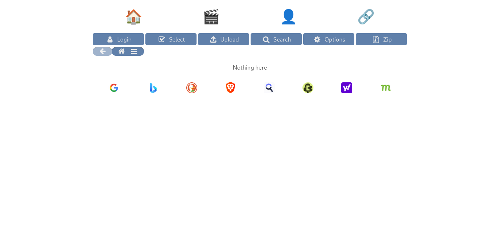

# Shortcut Bar

An [HFS](https://github.com/rejetto/hfs) plugin that adds **launcher bars of icon shortcuts**, managed entirely from the frontend. One engine drives two bars:

- **Main bar** — shown under the file list (`afterList`), for web shortcuts.
- **Header bar** — shown above the header (`beforeHeader`), for the site's own internal links.

Both bars share the same Customize UI, storage scheme, sharing rules and drag-and-drop behaviour.

Click the **+** on a bar and enter the URL — the shortcut is saved for the current account.



*The main launcher bar under the file list and the header bar of internal links.*

## Features

- **Wide icons**: tick **Wide (2 columns)** in the editor to let a single icon span two columns; a wide uploaded image is scaled to fill the tile's full height (no vertical gaps) and cropped horizontally as needed.
- **Zoom**: a per-shortcut **Zoom %** (10–500) scales the icon within its tile; above 100% it zooms in and is clipped to the tile.
- Images are downscaled to a PNG data-URL (128×128, or 256×128 for **Wide** icons); emoji and image URLs are supported too.
- **Automatic site icon** from the URL (DuckDuckGo's icon service). The editor also shows a strip of alternative icons for the site — its own `favicon.ico`, `favicon.svg` and `apple-touch-icon.png`, plus Simple Icons brand glyphs (handy when a service shares its parent's favicon, e.g. Google Drive vs Maps) — click one to use it, or override with an emoji, an image URL, or an upload. If the icon can't be loaded, the shortcut shows the 🔗 emoji.
- New shortcuts are added at the end; drag the **⠿** handle to reorder while in *Customize*. The admin's shared icons come first, then your own; shared icons follow the **admin's** order, and your own reordering is saved for your view.
- **Per-user storage** (server-side) for signed-in accounts; visitors (not signed in) are read-only.
- **Share individual icons**: an admin ticks the ✔ on any of their own icons to show it to everyone.
- **One combined bar**: shared icons appear alongside your own; you can reorder, hide or edit any of them for yourself. The layout **Reset** resets only the layout settings (icon size, icons-across, line gap, alignment and the Bar mode) — your order, hidden/edited shared icons and icon list are left as they are.
- **Per-user layout** per bar: icons-across, icon size, line gap, alignment and the **Bar** mode (Show / Hide / Hover) from *Customize*. The admin's choices are the defaults for everyone; each user can change their own and it's saved to their account. The main bar allows up to 64px icons and 24 icons across (starting at 8 across, 32px icons); the header bar allows up to 128px icons and 12 icons across (starting at 4 across, 64px icons).
- **Bar mode** (per bar, in *Customize*): **Show** keeps the bar visible; **Hide** shows only the **···** until it's clicked; **Hover** also auto-hides but reveals the icons while the pointer is over the bar — and it re-collapses after a shortcut is opened. Set independently for the main and header bars; the admin's choice is the default for everyone, and each user can override it for their own view (saved to their account). Both default to Show.
- **Internal links stay in the tab**: on the header bar, links that start with `/` open in the same tab; everything else opens a new one.
- Ships with 8 ready-made shared search-engine shortcuts (Google, Bing, DuckDuckGo, Brave Search, Startpage, Ecosia, Yahoo, Mojeek) plus a starter header bar of placeholder internal links you can edit.
- Live refresh across tabs/clients when shared icons or settings change.
- Visitors (not signed in) see shared icons read-only.
- **Fewer third-party requests**: favicon and suggested-icon images load with `referrerpolicy="no-referrer"` and `loading="lazy"`, so the icon provider never sees your HFS page URL and offscreen icons aren't requested until needed. Use an emoji or upload your own icon to avoid external requests entirely.

## Installation

1. Copy the `shortcuts` folder into your HFS `plugins` folder (portable: next to `hfs.exe`; Linux/macOS: `~/.hfs/plugins`).
2. Reload the Admin panel → **Plugins** and enable **shortcuts** if needed.

No build step and no dependencies.

## Usage

- When a bar is in **Hide** mode (see *Customize*), **click the ···** above the icons to show/hide them. In **Hover** mode the **···** appears only while the bar is empty — otherwise just point at the bar to reveal the icons. To open *Customize* (signed-in users only), **press and hold** an icon (or the **···** where shown) for the admin's *Hold time* (default 500 ms); right-click is no longer used. In **Show** mode the **···** is hidden while icons exist — press and hold an icon — and it only appears (to add one) when the bar is empty.
- Add a shortcut with **+**, then set the **URL** (optional — leave it blank for a non-clickable spacer tile) plus an optional **Label** and **Icon** (an emoji, an image URL, an uploaded file, or **Blank tile** for a transparent icon). A shortcut with no URL simply isn't clickable.
- Links must be web addresses (`http://` or `https://`) or relative paths. Other schemes, such as `javascript:`, are rejected, so a saved shortcut can never run script.
- Reorder with the **⠿** handle; layout controls (Icons across, Icon size, **Line gap** — the vertical space between rows — Alignment, and the **Bar** mode **Show** / **Hide** / **Hover**) appear inline; press **Done** when finished.
- **Export** and **Import** (in *Customize*, just left of **Done**): **Export** (after a confirmation) always saves **both bars** (top and bottom) to a JSON file of your own shortcuts and their saved positions. **Import** opens a popup with three choices that apply to **the bar you're customizing**: **Replace** (swap this bar's set and restore the saved positions), **Add** (append after your own, skipping duplicate URLs; keeps your current order), or **Restore** (bring back what was removed without deleting anything and reset the bar's positions — a regular user gets the admin's shared icons they had hidden shown again, and an admin gets the plugin's default icons re-added at their original spots; your own and your users' shortcuts are left untouched). Replace/Add then ask you to pick a file; Restore confirms first. Removing shortcuts is only done from the Customize view (the **×** / **Delete** in the editor). Only your own shortcuts are exported.

Each bar customizes independently: the header bar has its own icons, layout and order.

To use the header bar for the site's own links, remove any static nav block from your `custom.html` and add your links here instead — internal paths (like `/media`) open in the same tab.

### Sharing icons

While customizing, admins see a ✔ box on their own icons. Ticking it shares **that single icon** with everyone; other users can reorder, hide (**×**) or edit (**✎**) it for themselves only. An edited shared icon reverts with **Restore original** in the editor; the layout **Reset** does not touch these personal changes. Sharing is per bar.

### Admin settings (Admin panel → Plugins → shortcuts)

| Setting | Meaning |
|---|---|
| **Enable header shortcut bar** | Turn the above-header nav bar on/off. |
| **Disable tiles mode for the header bar** | When HFS is in tiles mode the header bar spans the full width; turn this on to keep it at the list width instead. |
| **Lock the header bar** | Non-admin users can't add their own shortcuts or change the bar's layout or shared icons — they only see what you set. |
| **Enable main shortcut bar** | Turn the under-list launcher bar on/off. |
| **Disable tiles mode for the main bar** | When HFS is in tiles mode the main bar spans the full width, matching the file list; turn this on to keep it at the list width instead. |
| **Lock the main bar** | Non-admin users can't add their own shortcuts or change the bar's layout or shared icons — they only see what you set. |
| **Show the bars to visitors who are not signed in** | If off, both bars are hidden until login. |
| **Hold time to customize** | How long (ms) to press and hold a shortcut or the **···** before Customize opens. Default 500. |

The admin's *Customize* settings are the defaults for everyone; each user can adjust their own icon size, icons-across, line gap, alignment, **Bar** mode and icon order, saved to their account. Both bars follow HFS's **tiles mode** by default (they span the full width when the file list is in tiles mode); the two *Disable tiles mode* settings opt a bar out, keeping it at the list width. **Lock** makes a bar read-only for non-admins (no adding, reordering, hiding or layout changes) while you keep full control. Site icons are favicons fetched by the viewing device at runtime (most via DuckDuckGo's icon service; Bing and Startpage via their own `favicon.ico`), so the device needs internet access; private/LAN addresses have no online icon and typically fall back to 🔗.

## Placement

The two bars attach to the frontend `afterList` and `beforeHeader` events. To move either, change the event name in [`public/main.js`](public/main.js):

```js
if (config.enabled !== false)
    HFS.onEvent('afterList', () => h(ShortcutBar, { bar: 'main' }))
if (config.headerEnabled !== false)
    HFS.onEvent('beforeHeader', () => h(ShortcutBar, { bar: 'header' }))
```

Other options include `afterMenuBar`, `afterHeader`, `footer`, etc.

## Storage

- Signed-in users: their list and layout are saved per account and per bar in `shortcuts.kv`.
  - Main list `u:<username>`, main layout `l:<username>`.
  - Header list `uh:<username>`, header layout `lh:<username>`.
- Shared icons are the items admins flagged with ✔, read per bar.
- Layout overrides are also mirrored in `localStorage` (namespaced by bar) for instant loading.
- The shared icons and the admin's default layout are computed once and cached per bar (invalidated as soon as shared icons or settings change), so reads stay cheap on large installs.
- Visitors: read-only (shared icons only).
- Saves are capped for safety: about 128 KB per icon, up to 250 icons per bar, up to 100 personal edits, and about 2 MB total per save, with a per-user write throttle. Links are limited to `http(s)` or site-relative paths.

## Files

- [`plugin.js`](plugin.js) — backend: config, per-user/per-bar storage, sharing, REST handlers, notifications.
- [`public/main.js`](public/main.js) — frontend: bars, drag & drop, editor, layout controls.
- [`public/style.css`](public/style.css) — styles (HFS theme variables for light/dark).

## License

MIT — see [`LICENSE`](LICENSE). Copyright (c) 2026 buildnbrk.

No third-party artwork is bundled: the shipped shortcuts are names, URLs and Unicode emoji. Site icons are fetched at runtime by the viewing browser from third-party services, and the search-engine names are trademarks of their respective owners.
